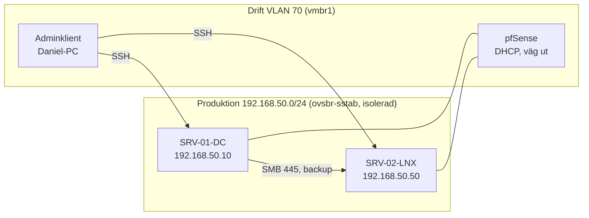

# Miljön på Proxmox

Skämt & Sido Transport AB:s två servrar körs som virtuella maskiner på Proxmox VE i hemlabbet. De skapas med Terraform från färdiga mallar, på samma sätt som i kurs 1.

## Översikt

| VM | Namn | Operativsystem | Roll | Produktion | Drift |
|---|---|---|---|---|---|
| 331 | SRV-01-DC | Windows Server 2025 | AD DS, DNS, DHCP, Windows Server Backup | 192.168.50.10 | 10.10.70.125 (DHCP) |
| 332 | SRV-02-LNX | Ubuntu Server 26.04 LTS | Samba, backupmål | 192.168.50.50 | 10.10.70.124 (DHCP) |

| Mall | Innehåll |
|---|---|
| 9010 `winserver2025-tpl` | Windows Server 2025, cloudbase-init, OpenSSH med nyckel, virtio-drivrutiner, gästagent |
| 9001 `ubuntu-2604-cloudinit` | Ubuntu 26.04 cloud image med cloud-init |

## Nätet



Varje server har två nätverkskort:

| Kort | Brygga på Proxmox | Användning |
|---|---|---|
| Produktion | `ovsbr-sstab` | Företagets nät enligt IP-planen. AD, DNS, DHCP till klienter och backuptrafiken |
| Drift | `vmbr1`, VLAN 70 | SSH från adminklienten och uppdateringar från internet |

Produktionsnätet är en egen virtuell switch, Open vSwitch-bryggan `ovsbr-sstab`, utan fysisk port. Den motsvarar SW01 i IP-planen. Trafiken mellan servrarna, till exempel backupen, går bara i den bryggan och kommer aldrig ut på hemnätet. Gatewayen 192.168.50.1 (FW01) finns i IP-planen men inte i labbet, så produktionsnätet har ingen väg ut.

### Skapa den virtuella switchen

Körs en gång som root på Proxmox:

```bash
ovs-vsctl --may-exist add-br ovsbr-sstab
ovs-vsctl list-br
```

Bryggan sparas i Open vSwitch egen databas och finns kvar efter omstart. Den skrivs inte in i `/etc/network/interfaces`. Ett fel i labbets brygga kan då inte hindra Proxmox egna nät `vmbr0` och `vmbr1` från att komma upp, och de bär alla andra maskiner på värden.

## Skapa servrarna

Terraform-koden ligger i `C:\Users\labon\Documents\infra-sstab-proxmox`.

| Fil | Innehåll |
|---|---|
| `main.tf` | De två maskinerna och cloud-init-filerna |
| `variables.tf`, `providers.tf` | Proxmox-adress, API-token, bryggor |
| `terraform.tfvars` | Token och nycklar. Hemlig, aldrig i git |
| `cloud-init/` | Nätverk och användare för SRV-02-LNX |

```powershell
cd C:\Users\labon\Documents\infra-sstab-proxmox
terraform plan -out=tfplan
terraform apply tfplan
```

Planen ska visa `4 to add, 0 to change, 0 to destroy` vid första bygget. Läs alltid planen innan `apply`.

Saker i koden som är medvetna val:

* **Fasta MAC-adresser.** Driftkorten får samma adress från pfSense även när en maskin byggs om, och Windows-skripten hittar rätt kort via MAC-adressen.
* **En egen backupdisk på SRV-02-LNX** (100 GB, `scsi1`). En full backupdisk kan inte fylla systemdisken, och disken kan flyttas till en annan maskin.
* **`ignore_changes`** på cloud-init-filerna, `machine` och `tags`. Annars vill Terraform ersätta eller stänga av maskinerna vid nästa körning, se kurs 1.

## Efter bygget

| Server | Nästa steg |
|---|---|
| SRV-02-LNX | [02 Backupmålet SRV-02-LNX](02-backupmal-srv-02-lnx.md) |
| SRV-01-DC | `skript/windows/01-grund.ps1`: nätverkskorten döps till Drift och Produktion, fast adress 192.168.50.10, tidszon och datornamnet SRV-01-DC. Datornamnet måste vara rätt innan servern blir domänkontrollant |

Steg 1 på SRV-01-DC körs över SSH från adminklienten och följs av en omstart:

```powershell
scp skript\windows\01-grund.ps1 Administrator@10.10.70.125:C:/sstab-skript/
ssh Administrator@10.10.70.125 "powershell -NoProfile -ExecutionPolicy Bypass -File C:\sstab-skript\01-grund.ps1"
```

Utskrift efter omstart:

```text
SRV-01-DC

InterfaceAlias IPAddress     PrefixOrigin
-------------- ---------     ------------
Produktion     192.168.50.10       Manual
Drift          10.10.70.125          Dhcp
```

## Inloggning

| Server | Kommando från adminklienten (PowerShell) |
|---|---|
| SRV-01-DC | `ssh Administrator@10.10.70.125` |
| SRV-02-LNX | `ssh daniel@10.10.70.124` |

Båda tar bara nyckel. Reservväg är konsolen i Proxmox webbgränssnitt.
